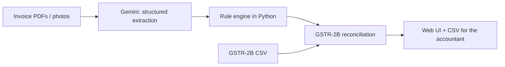

# GST Invoice Agent

**Reads purchase invoices with Gemini, checks every GST rule in code, and reconciles them against GSTR-2B,
so a business claims only the input tax credit (ITC) it can defend.**

## The problem

Every month, Indian businesses collect supplier invoices as PDFs, scans and WhatsApp photos. Someone types
them into Tally or Excel by hand, and then has to match them against **GSTR-2B**, the portal statement of
what suppliers actually filed. ITC is only allowed on invoices that appear there. The mistakes are common
and expensive:

- a supplier never files the invoice, so the credit gets reversed with interest;
- IGST is charged on an intra-state sale (or CGST+SGST on an inter-state one), so the credit is disputed;
- the GSTIN has a typo, tax is worked out at the wrong rate, or the total doesn't add up;
- the same invoice gets entered twice;
- an invoice is billed to a different branch's GSTIN, so this entity can't claim it.

## What it does



1. **Extract.** Gemini reads each document into a fixed JSON schema: GSTINs, invoice number, date, line
   items, rates and tax totals. It is told to copy numbers exactly as printed, even when they are wrong.
2. **Validate in code.** The model never decides what's compliant. Deterministic checks do:

   | Check | Rule |
   |---|---|
   | GSTIN | Format, state code and mod-36 checksum, for both supplier and buyer |
   | Wrong buyer | Invoice must be billed to *your* GSTIN to claim ITC |
   | Tax type | Same state → CGST + SGST (equal); different state → IGST, using the place of supply |
   | Tax math | Tax charged = Σ line value × rate; rate must be a valid GST slab |
   | Totals | Lines add up to the taxable value; taxable + tax + round-off = total |
   | Invoice number | Rule 46: at most 16 characters, letters, digits, `-` and `/` |
   | Duplicates | Same supplier and invoice number, ignoring formatting (`INV/001` = `inv-0001`) |
   | Date | Valid and not in the future |

3. **Reconcile with GSTR-2B.** Every invoice gets one status: *matched*, *amount mismatch*, *missing in 2B*
   (ITC at risk) or *missing in books* (credit you're entitled to but haven't recorded). Each one comes
   with the action to take.

## Demo, no API key needed

The repo ships a synthetic month of 12 invoices for a fictional company, with problems planted in them,
plus a matching GSTR-2B:

```bash
pip install -r requirements.txt
uvicorn app:app            # open http://127.0.0.1:8000 and click "Try the sample batch"
```

Or from the command line:

```bash
python -m gst_agent data/invoices --our-gstin 29AABCN4821K1ZA --gstr2b data/gstr2b.csv --offline
```

```
Read 12/12 invoices: 5 clean, 6 with errors, 1 with warnings
  [error  ] inv05.png: Supplier GSTIN '07AACCY2267H1Z3': checksum fails (expected 7, got 3)
  [error  ] inv06.png: Intra-state supply charged IGST; it should be CGST + SGST. ITC will be disputed.
  [error  ] inv07.png: Tax charged 10,320.00 but line rates give 15,480.00
  [error  ] inv08.png: Taxable + tax = 44,100.00, invoice total says 44,600.00
  [error  ] inv09.png: Same supplier and invoice number as inv02.png. Claiming twice is fraud risk.
  [error  ] inv10.png: Billed to 27AABCN4821K2ZD, not your GSTIN 29AABCN4821K1ZA. ITC cannot be claimed on it.
  [warning] inv12.png: Invoice number 'SC-26-27-EXPORT-3398' breaks Rule 46 (1-16 chars, letters, digits, - or /)
GSTR-2B: 7 matched, 1 amount mismatch, 3 missing in 2B, 2 missing in books
ITC at risk: Rs 17,190.00   Unclaimed ITC found in 2B: Rs 11,448.00
```

`--offline` reads the ground-truth JSON stored next to each sample image instead of calling Gemini, so the
rules and reconciliation can be shown and tested without a key.

## With real invoices

```bash
export GEMINI_API_KEY=your-key       # free key: https://aistudio.google.com/apikey
uvicorn app:app                      # upload PDFs/photos + your GSTR-2B CSV in the browser
python -m gst_agent path/to/invoices --our-gstin <yours> --gstr2b gstr2b.csv
```

The GSTR-2B input is a CSV with these columns:
`supplier_gstin, invoice_number, invoice_date, taxable_value, igst, cgst, sgst`.

## Extraction accuracy

`evaluate.py` runs Gemini on the 12 sample invoice images. It reports field-level accuracy and, more
importantly, on how many invoices the full pipeline caught exactly the planted problems with no false alarms.

```bash
GEMINI_API_KEY=... python evaluate.py
```

| Metric | Value |
|---|---|
| Field-level extraction accuracy | _run evaluate.py_ |
| Invoices with every planted issue caught, no false alarms | _run evaluate.py_ |
| Avg seconds per invoice | _run evaluate.py_ |

## Tests

```bash
pytest
```

There are 30 tests: real GSTINs, each GST rule, all reconciliation statuses, the full sample batch
end to end, Gemini extraction with a fake API, and the web API, including upload filename sanitisation.
CI runs them on every push.

## Project layout

| Path | What |
|---|---|
| `gst_agent/gstin.py` | GSTIN format, state codes, checksum |
| `gst_agent/validate.py` | GST rule engine and duplicate detection |
| `gst_agent/reconcile.py` | Books vs GSTR-2B reconciliation |
| `gst_agent/extract.py` | Gemini structured extraction (standard library only) |
| `gst_agent/pipeline.py` | Extract → validate → reconcile, CSV exports |
| `app.py`, `static/index.html` | FastAPI backend and single-page UI |
| `scripts/make_samples.py` | Generates the synthetic invoices and GSTR-2B |
| `evaluate.py` | Live extraction accuracy benchmark |

## Limits

- GSTR-2B is read from a simplified CSV, not the portal's own Excel/JSON download.
- Amounts are compared with a ₹1 tolerance for rounding. Reverse charge, credit notes and blocked credits
  under Section 17(5) are not handled yet.
- All sample companies and GSTINs are fictional. The GSTINs have valid checksums, but the PANs are made up.
